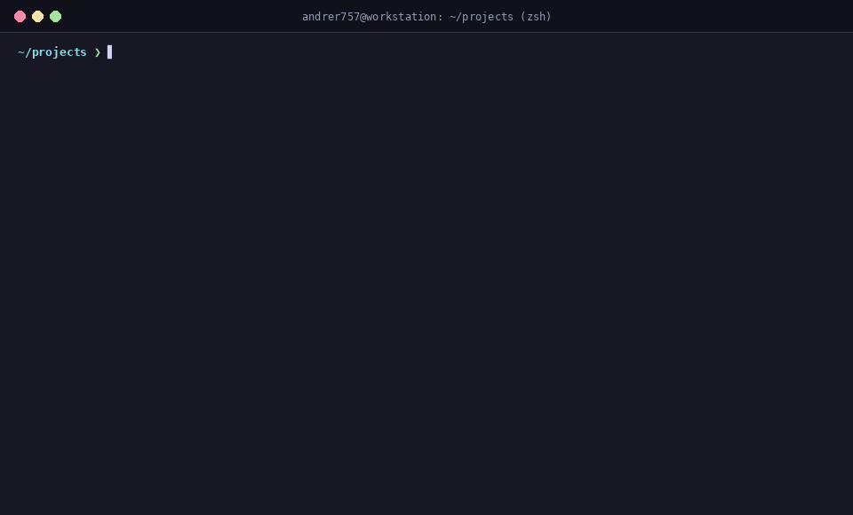
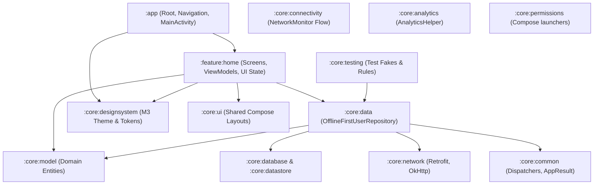
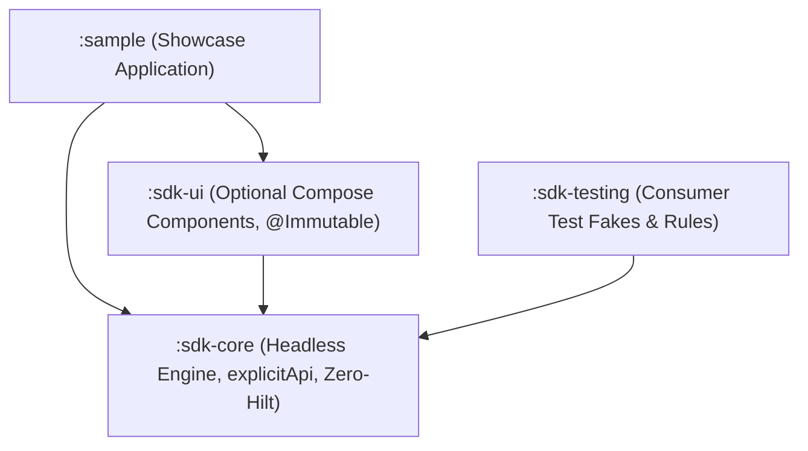

# Kickoff

> **Deterministic Android Scaffolding Engine, Multi-Module Compose Templates, Day-2 Generators & AI MCP Platform**

<p align="center">
  
</p>

Kickoff is a deterministic developer CLI and AI engineering platform designed to bootstrap and evolve production-grade Android applications and redistributable SDK libraries. It implements Google's **Now-in-Android** Clean Architecture, **Jetpack Compose (Material 3)**, **Hilt**, **Room**, **Retrofit**, Binary Compatibility Validator, and an integrated static code analysis suite.

Scaffolded projects don't just ship with code—they come equipped with an integrated **AI Agent Swarm** dynamically synthesized for **GitHub Copilot**, **Claude Code**, **Cursor**, and **Antigravity / Generic AI agents**, backed by a native **Model Context Protocol (MCP)** server.

---

## Documentation Index

- 📖 [**Architecture Deep-Dive**](docs/ARCHITECTURE.md): Complete module topologies for both App (`now-in-android`) and SDK (`android-sdk`) archetypes.
- 🤖 [**AI Agent Kit & MCP**](docs/AI_AGENT_KIT.md): Catalog of 16 specialized agents, 25 atomic skills, cross-IDE setup, and stdio MCP server.
- 🛡️ [**Quality Verifier Plugin**](docs/QUALITY_VERIFIER.md): Detekt (Compose rules), Spotless (Ktlint), typed Android Lint, Architecture boundary verifier, and Kover.
- 🤝 [**Contributing Guide**](CONTRIBUTING.md): How to build, test, and contribute to Kickoff as an open-source project.

---

## Monorepo Architecture

Kickoff unifies five mature Android engineering foundations into a single modern monorepo:

```
Kickoff-V2/
├── kickoff                              # Root wrapper script for the CLI generator
├── kickoff-cli/                         # Standalone CLI & MCP server (Kotlin 2.0.21 + Clikt 5)
├── quality-verifier/                    # Standalone Gradle plugin (eu.andrer757.quality-verifier)
├── templates/
│   ├── now-in-android/                  # Multi-module App template (Now-in-Android)
│   │   ├── build-logic/                 # Gradle convention plugins
│   │   ├── gradle/libs.versions.toml    # Centralized version catalog
│   │   ├── app/                         # Application entrypoint & navigation
│   │   ├── core/                        # Core capabilities (:core:data, :core:testing, :core:model, etc.)
│   │   ├── feature/                     # Feature modules (:feature:home)
│   │   ├── .agents/                     # Single Source of Truth (SSoT) for AI swarm
│   │   └── scripts/                     # Cross-platform AI setup scripts (.sh, .ps1)
│   └── android-sdk/                     # Multi-module Android SDK + Sample template
│       ├── build-logic/                 # SdkLibrary, SdkCompose, SdkPublish convention plugins
│       ├── sdk-core/                    # Headless engine (explicitApi, zero-Hilt, consumer ProGuard)
│       ├── sdk-ui/                      # Compose UI components (@Immutable / @Stable)
│       ├── sdk-testing/                 # Consumer test fakes & rules (FakeSdkClient)
│       └── sample/                      # Showcase Compose application
├── .github/workflows/                   # Monorepo CI & automated release workflows
└── .agents/skills/kickoff-scaffold/     # AI Agent skill for invoking Kickoff
```

---

## Quickstart

### Prerequisites
- **JDK 17 or JDK 21** (Eclipse Temurin 21 recommended)
- **Android SDK** (API 35 SDK installed)

### 1. Install Kickoff CLI

#### Option A: One-Command Binary Installer (Linux & macOS)
```bash
curl -fsSL https://raw.githubusercontent.com/Andrer757/Kickoff-V2/main/install.sh | bash
```

#### Option B: Homebrew
```bash
brew install Andrer757/Kickoff-V2/kickoff
```

#### Option C: Build from Source (Monorepo)
```bash
git clone https://github.com/Andrer757/Kickoff-V2.git
cd Kickoff-V2
./gradlew :kickoff-cli:installDist
```

### 2. Scaffold a New Project

#### Scaffold an Android Application (Default)
```bash
./kickoff new \
  --name "Crypto Tracker" \
  --package "com.example.cryptotracker" \
  --output "~/projects/crypto-tracker"
```

#### Scaffold a Redistributable Android SDK + Sample App
```bash
./kickoff new \
  --name "Payment SDK" \
  --package "com.example.paymentsdk" \
  --type sdk \
  --output "~/projects/payment-sdk"
```

### 3. Build & Verify Generated App
```bash
cd ~/projects/crypto-tracker
./gradlew assembleDebug
./gradlew check
```

---

## Full CLI Command Suite

Kickoff provides a full suite of commands for Day-1 scaffolding and Day-2 codebase evolution:

```
Usage: kickoff [<options>] <command> [<args>]...

Commands:
  new          Scaffold a new Android App or SDK project
  add          Add new features, modules, or database entities to an existing project
  arch-check   Sub-100ms static Clean Architecture & SDK boundary verification
  doctor       Diagnose developer environment, JDK, Android SDK, and AI tools
  mcp          Run Kickoff as a Model Context Protocol (MCP) stdio server
```

### 1. `kickoff new`
```
Options:
  -n, --name=<text>      Project name (Required, e.g. "Fitness App")
  -p, --package=<text>   Application package name (Required, e.g. "com.example.fitness")
  -o, --output=<text>    Target output directory (Defaults to sanitized project name)
  --type=<app|sdk>       Project archetype: app (Now-in-Android), sdk (Android SDK + Sample) (Default: app)
  -t, --template=<text>  Path to custom template
  --min-sdk=<int>        Minimum SDK API level (Default: 26)
  --target-sdk=<int>     Target SDK API level (Default: 35)
  --ai=<text>            Target AI environment: copilot, claude, cursor, generic, all, none (Default: all)
  --git / --no-git       Initialize git repository with initial commit (Default: true)
  --json                 Output result as structured machine-readable JSON
```

### 2. `kickoff add feature`
Auto-generates a new feature module and wires it into `settings.gradle.kts`, `app/build.gradle.kts`, and `MainActivity.kt`'s `NavHost`:
```bash
./kickoff add feature --name settings
```

### 3. `kickoff add module`
Scaffolds a `:core:<name>` module in an App project or `:sdk-<name>` in an SDK project:
```bash
./kickoff add module --name analytics --type core
./kickoff add module --name telemetry --type sdk
```

### 4. `kickoff add entity`
Scaffolds a domain model, Room `@Entity`, `@Dao`, and offline-first repository across `:core:model`, `:core:database`, and `:core:data`:
```bash
./kickoff add entity --name Article --fields "id:String,title:String,content:String"
```

### 5. `kickoff arch-check`
Validates Clean Architecture module boundaries without needing a Gradle daemon:
```bash
./kickoff arch-check
```

### 6. `kickoff doctor`
Diagnoses JDK, Android SDK, Gradle wrapper, and AI tools:
```bash
./kickoff doctor [--json]
```

### 7. `kickoff mcp`
Launches the built-in stdio Model Context Protocol (MCP) server exposing tools directly to Claude Code, Cursor, Antigravity, and Windsurf:
```bash
./kickoff mcp
```

Configure in Claude Desktop / Cursor / Antigravity (`mcpServers`):
```json
{
  "mcpServers": {
    "kickoff": {
      "command": "kickoff",
      "args": ["mcp"]
    }
  }
}
```
*(Or specify `/path/to/Kickoff-V2/kickoff` if running directly from a monorepo checkout).*

---

## Generated Architectures

### 1. Now-in-Android Application Architecture (`--type app`)

Scaffolded applications strictly follow Google's official **Now in Android** Clean Architecture design:



### 2. Android SDK Architecture (`--type sdk`)

Scaffolded SDK suites provide a redistributable, binary-compatible library setup with an interactive showcase app:



---

## Contributing

Kickoff is an open-source project and welcomes contributions from the community! Check out our [**Contributing Guide**](CONTRIBUTING.md) for instructions on setting up your local environment, running tests, and opening Pull Requests.

---

## License

This project is licensed under the [MIT License](LICENSE.md).
