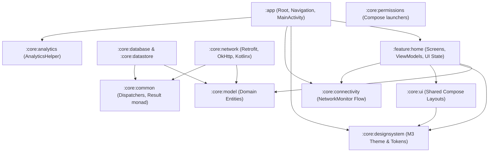

# Kickoff

> **Deterministic Android Scaffolding Engine, Multi-Module Compose Template & Multi-Agent AI Ecosystem**

Kickoff is a deterministic developer and AI CLI tool designed to bootstrap production-ready Android applications following Google's **Now-in-Android** multi-module architecture, **Jetpack Compose (Material 3)**, **Hilt**, **Room**, **Retrofit**, and an automated static code analysis suite.

Scaffolded projects don't just ship with code—they come equipped with an integrated **AI Agent Swarm** pre-configured for **GitHub Copilot**, **Claude Code**, **Cursor**, and **Antigravity / Generic AI agents**.

---

## Documentation Index

- 📖 [**Architecture Deep-Dive**](docs/ARCHITECTURE.md): Complete module topology, Clean Architecture rules, and absorbed ADAL core modules.
- 🤖 [**AI Agent Kit**](docs/AI_AGENT_KIT.md): Catalog of 16 specialized agents, 25 atomic skills, cross-IDE setup, and dependency scripts.
- 🛡️ [**Quality Verifier Plugin**](docs/QUALITY_VERIFIER.md): Detekt (Compose rules), Spotless (Ktlint), Android Lint, and Kover configuration.
- 🤝 [**Contributing Guide**](CONTRIBUTING.md): How to build, test, and contribute to Kickoff as an open-source project.

---

## Monorepo Architecture

Kickoff unifies three mature Android engineering foundations into a single modern monorepo:

```
kickoff-my/
├── kickoff                              # Root wrapper script for the CLI generator
├── kickoff-cli/                         # Standalone CLI application (Kotlin 2.0.21 + Clikt 5)
├── quality-verifier/                    # Standalone Gradle plugin (pt.simdea.quality-verifier)
├── templates/
│   └── now-in-android/                  # Uncompressed multi-module template with AI kit
│       ├── build-logic/                 # Gradle convention plugins
│       ├── gradle/libs.versions.toml    # Centralized version catalog
│       ├── app/                         # Application entrypoint & navigation
│       ├── core/                        # Core capability modules (ADAL absorbed)
│       ├── feature/                     # Feature modules (:feature:home)
│       ├── .github/                     # GitHub Copilot agents, skills & governance
│       ├── .claude/                     # Claude Code agents & skills
│       ├── .cursor/                     # Cursor rules (*.mdc)
│       ├── .agents/                     # Antigravity / Generic AI agents & skills
│       └── scripts/                     # Cross-platform AI setup scripts (.sh, .ps1)
└── .agents/skills/kickoff-scaffold/     # AI Agent skill for invoking Kickoff
```

---

## Quickstart

### Prerequisites
- **JDK 17 or JDK 21** (Eclipse Temurin 21 recommended)
- **Gradle 8.12** (managed automatically via `./gradlew`)
- **Android SDK** (API 35 SDK installed)

### 1. Build Kickoff CLI
```bash
./gradlew :kickoff-cli:installDist
```

### 2. Scaffold a New Project
```bash
./kickoff new \
  --name "Crypto Tracker" \
  --package "com.example.cryptotracker" \
  --output "~/projects/crypto-tracker"
```

### 3. Build & Verify Generated App
```bash
cd ~/projects/crypto-tracker
./gradlew assembleDebug
./gradlew check
```

---

## CLI Parameters & Options

```
Usage: kickoff new [<options>]

Options:
  -n, --name=<text>      Project name (Required, e.g. "Fitness App")
  -p, --package=<text>   Application package name (Required, e.g. "com.example.fitness")
  -o, --output=<text>    Target output directory (Defaults to sanitized project name)
  -t, --template=<text>  Path to custom template (Defaults to templates/now-in-android)
  --min-sdk=<int>        Minimum SDK API level (Default: 26)
  --target-sdk=<int>     Target SDK API level (Default: 35)
  --ai=<text>            Target AI environment: copilot, claude, cursor, generic, all, none
                         (Default: all, supports comma-separated values)
  --json                 Output result as structured machine-readable JSON
  -h, --help             Show help message and exit
```

### Tailoring AI Environments (`--ai`)

Developers and CI workflows can install only the AI configurations needed:

| Command | Installed AI Configurations |
|---|---|
| `./kickoff new ... --ai all` | *(Default)* Installs Copilot, Claude Code, Cursor, and Generic kits |
| `./kickoff new ... --ai copilot` | Installs `.github/agents/`, `.github/skills/`, and governance |
| `./kickoff new ... --ai claude` | Installs `.claude/agents/`, `.claude/skills/`, and settings |
| `./kickoff new ... --ai cursor` | Installs `.cursor/rules/*.mdc` and `.agents/skills/` |
| `./kickoff new ... --ai generic` | Installs `.agents/agents/` and `.agents/skills/` (Antigravity/Codex) |
| `./kickoff new ... --ai claude,cursor` | Installs both Claude Code and Cursor environments |
| `./kickoff new ... --ai none` | Scaffolds a clean Android project without any AI directories |

### Machine-Readable Output (`--json`)

Coding assistants (Antigravity, Claude Code, Cursor, Windsurf) can pass `--json` to parse generated project paths, modules, and entrypoints directly:

```json
{
  "status": "success",
  "projectPath": "/home/user/projects/crypto-tracker",
  "projectName": "Crypto Tracker",
  "packageName": "com.example.cryptotracker",
  "modules": [
    ":app",
    ":build-logic:convention",
    ":core:analytics",
    ":core:common",
    ":core:connectivity",
    ":core:database",
    ":core:datastore",
    ":core:designsystem",
    ":core:model",
    ":core:network",
    ":core:permissions",
    ":core:ui",
    ":feature:home"
  ],
  "aiEnvironments": [
    "all"
  ],
  "entryPoints": {
    "application": "app/src/main/kotlin/com/example/cryptotracker/KickoffApplication.kt",
    "mainActivity": "app/src/main/kotlin/com/example/cryptotracker/MainActivity.kt",
    "homeScreen": "feature/home/src/main/kotlin/com/example/cryptotracker/feature/home/HomeScreen.kt"
  }
}
```

---

## Generated Android Project Architecture

The scaffolded project strictly implements Google's **Now in Android** Clean Architecture guidelines:



For detailed module responsibilities, see [**docs/ARCHITECTURE.md**](docs/ARCHITECTURE.md).

---

## Contributing

Kickoff is an open-source project and welcomes contributions from the community! Check out our [**Contributing Guide**](CONTRIBUTING.md) for instructions on setting up your local environment, running tests, and opening Pull Requests.

---

## License

This project is licensed under the [MIT License](LICENSE.md).
