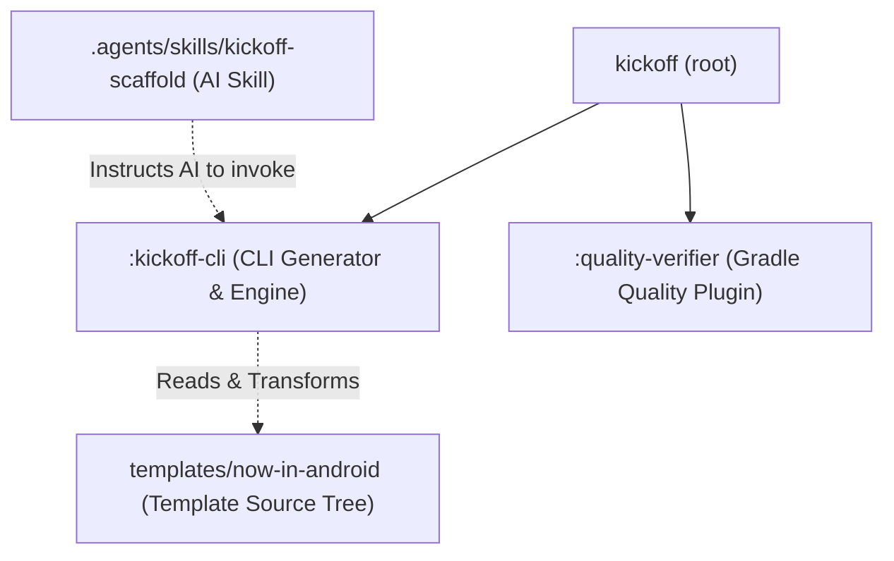
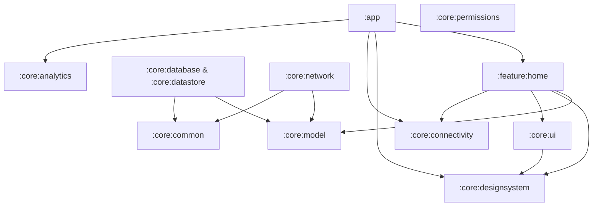

# Architecture Deep-Dive

This document details the architectural design of **Kickoff**, including the internal generator engine and the multi-module Now-in-Android template.

---

## 1. Kickoff Monorepo Architecture

Kickoff is engineered as a multi-project Gradle monorepo:

### Subproject Responsibilities

| Subproject | Responsibility | Technologies |
|---|---|---|
| `:kickoff-cli` | Command-line parser, project token replacer, and directory remapper | Kotlin 2.0.21, Clikt 5, Kotlinx Serialization |
| `:quality-verifier` | Gradle static analysis plugin (`pt.andrer757.quality-verifier`) | Detekt (Compose rules), Spotless (Ktlint), Android Lint, Kover |
| `templates/now-in-android` | Uncompressed, git-tracked production Android template | AGP 8.8, Compose M3, Hilt, Room, Retrofit |

---

## 2. Generated Project Architecture (Now in Android)

Scaffolded applications follow Google's official **Now in Android** Clean Architecture design principles:

### Module Dependency Rules

1. **`:core:model` is innermost**: Contains domain entities and data classes. Has zero dependencies on Android frameworks, Room, or Hilt.
2. **`:core:common` provides foundational utilities**: Coroutine dispatchers (`@Dispatcher`), Result monad (`AppResult`), and common Kotlin extensions.
3. **Features never depend on each other**: Cross-feature communication happens via navigation callbacks in `:app` or shared domain models in `:core:model`.
4. **Data layer encapsulates storage**: `:core:database` (Room) and `:core:network` (Retrofit) expose Kotlin `Flow` contracts to feature ViewModels.

---

## 3. Core Capability Modules

Kickoff provides essential foundation utilities written in pure Kotlin and Jetpack Compose:

| Module | Implementation Pattern |
|---|---|
| `:core:connectivity` | `NetworkMonitor.isOnline` emitting a `Flow<Boolean>` via `ConnectivityManager.NetworkCallback` and `callbackFlow`. Injected via Hilt. |
| `:core:analytics` | Typed `AnalyticsHelper` contract with `AnalyticsEvent(type, properties)`. Includes `LoggingAnalyticsHelper` default, easily swapped with Firebase or Mixpanel. |
| `:core:permissions` | Declarative `rememberPermissionLauncher` composable wrapping `ActivityResultContracts.RequestPermission` with rationale callbacks. |
| `:core:common` | Clean Architecture `AppResult<T>` sealed hierarchy, `@Dispatcher(AppDispatchers.IO)` qualifiers, and Coroutine extensions. |

---

## 4. Gradle Convention Plugins (`build-logic`)

Instead of duplicating build configuration across 12 modules, the template uses Gradle convention plugins located in `build-logic/`:

- **`kickoff.android.application`**: Configures compileSdk 35, minSdk 26, targetSdk 35, Java 17 toolchain, and packaging options.
- **`kickoff.android.library`**: Configures Android library settings, test runner, and Java 17 toolchain.
- **`kickoff.android.compose`**: Enables Compose compiler plugin, Compose BOM, and core Material 3 dependencies.
- **`kickoff.android.hilt`**: Applies KSP and Dagger Hilt plugin, injecting Hilt compiler and runtime dependencies.
- **`kickoff.android.room`**: Configures Room Gradle plugin, KSP annotation processor, and schema export directories.
- **`kickoff.android.feature`**: Bundles `library`, `compose`, `hilt`, navigation compose, and core designsystem dependencies for feature modules.

---

## 5. Generator Engine (`ProjectGenerator.kt`)

The Kickoff generator operates deterministically:
1. **Uncompressed Source Walking**: Recursively traverses `templates/now-in-android`.
2. **AI Environment Filtering**: Checks `--ai` flags (copilot, claude, cursor, generic, all, none) and conditionally skips unwanted AI dot-directories.
3. **Dynamic Package Path Remapping**: Replaces all `app_package` directory tokens with the user-provided package structure (e.g. `com/example/myapp`).
4. **Token Replacement**: Replaces `${configs.projectName}`, `${configs.packageName}`, `${configs.minSdk}`, and `${configs.targetSdk}` across code, build, and configuration files.
5. **Permission Restoration**: Automatically flags `gradlew` and `.sh` scripts as executable.
