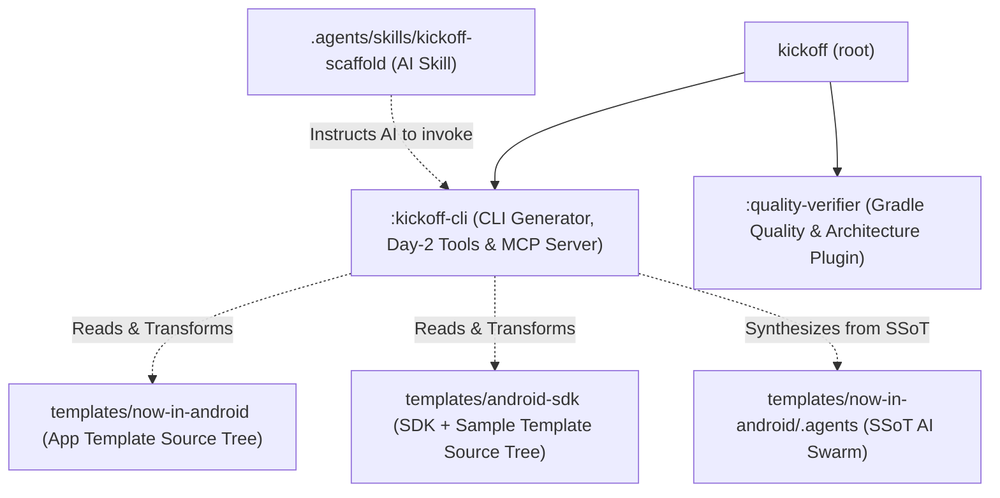
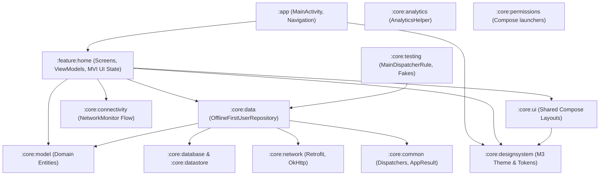
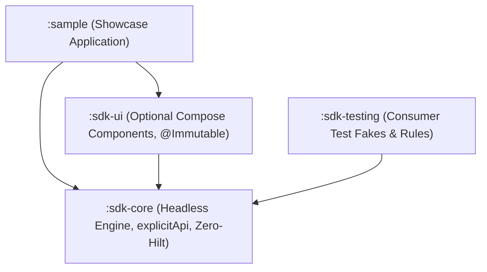

# Architecture Deep-Dive

This document details the architectural design of **Kickoff**, including the internal generator engine, Day-2 incremental generators, the multi-module Now-in-Android App template, and the redistributable Android SDK library template.

---

## 1. Kickoff Monorepo Architecture

Kickoff is engineered as a multi-project Gradle monorepo:

### Subproject Responsibilities

| Subproject | Responsibility | Technologies |
|---|---|---|
| `:kickoff-cli` | Command-line parser, project token replacer, AI synthesizer, Day-2 commands, and stdio MCP server | Kotlin 2.0.21, Clikt 5, Kotlinx Serialization |
| `:quality-verifier` | Gradle static analysis and Clean Architecture verification plugin (`pt.andrer757.quality-verifier`) | AGP 8.8 CommonExtension, Detekt (Compose rules), Spotless (Ktlint), Android Lint, Kover |
| `templates/now-in-android` | Uncompressed, git-tracked production Android App template with SSoT AI kit | AGP 8.8, Compose M3, Hilt, Room, Retrofit, DataStore |
| `templates/android-sdk` | Uncompressed, git-tracked multi-module Android SDK + Sample App template | AGP 8.8, Compose M3, BCV (0.17.0), Dokka (2.0.0), Maven Publish |

---

## 2. Generated App Architecture (Now in Android — `--type app`)

Scaffolded applications follow Google's official **Now in Android** Clean Architecture design principles:

### App Dependency & Boundary Invariants

1. **`:core:model` is innermost**: Contains domain entities and data classes. Has zero dependencies on Android frameworks, Room, Hilt, or other internal modules.
2. **`:core:data` encapsulates storage and sync**: Exposes clean Kotlin `Flow` contracts to feature ViewModels. Feature modules must access data via `:core:data`, never directly depending on `:core:database`, `:core:network`, or `:core:datastore`.
3. **Features never depend on each other**: Cross-feature communication happens via navigation callbacks in `:app` or shared domain models in `:core:model`.
4. **`:core:testing` provides deterministic test doubles**: Supplies `MainDispatcherRule`, `FakeUserRepository`, and `FakeNetworkMonitor` for fast unit tests without Robolectric overhead.

---

## 3. Generated SDK Architecture (Android SDK + Sample — `--type sdk`)

Scaffolded SDK suites provide a redistributable, binary-compatible library setup with an interactive showcase app:

### SDK Safeguards & Capabilities

1. **`explicitApi()` Enforcement**: Enabled across `:sdk-core` and `:sdk-ui`. Every public class, function, and property must explicitly declare visibility and return types to prevent accidental API surface leaks.
2. **Binary Compatibility Validator (BCV)**: Pre-configured with Kotlin BCV (`org.jetbrains.kotlinx.binary-compatibility-validator`). Automatically verifies public ABI dumps (`api/*.api`) during `./gradlew apiCheck` and `./gradlew check`.
3. **Zero-Hilt Public Surface**: `:sdk-core` uses an internal manual DI container (`InternalSdkClient`) rather than forcing host consumer applications to adopt Dagger/Hilt.
4. **Consumer ProGuard Rules**: Bundles `consumer-rules.pro` into published AARs, guaranteeing host apps will not strip public SDK entry points during R8 optimization.
5. **Maven Publishing & Dokka**: Pre-configured `kickoff.sdk.publish` plugin generating release AARs, sources JARs, Javadoc JARs, and Dokka documentation ready for `publishToMavenLocal` or Maven Central.

---

## 4. Generator Engine & SSoT AI Synthesizer

The Kickoff generator operates deterministically:

1. **Uncompressed Source Walking**: Traverses `templates/now-in-android` (for `--type app`) or `templates/android-sdk` (for `--type sdk`).
2. **Single Source of Truth AI Synthesis**: Reads canonical Markdown definitions from `templates/now-in-android/.agents/` and dynamically generates target configurations:
   - **Claude Code**: `.claude/agents/*.md` with tool bindings and `settings.json`.
   - **GitHub Copilot**: `.github/agents/*.agent.md` with user-invocable tags and governance.
   - **Cursor**: `.cursor/rules/*.mdc` with glob filters and `.agents/skills/`.
   - **Generic / Antigravity**: `.agents/agents/*.md` and `.agents/skills/`.
3. **Dynamic Package Path Remapping**: Replaces all `app_package` directory tokens with the user-provided package structure (e.g. `com/example/myapp`).
4. **Token Replacement**: Replaces `${configs.projectName}`, `${configs.packageName}`, `${configs.minSdk}`, and `${configs.targetSdk}`. In BCV `.api` files, package tokens are formatted with JVM descriptor slashes (`com/example/myapp`).
5. **Git Repository Initialization**: Automatically runs `git init`, stages files, and creates an initial commit (unless `--no-git` is specified).
6. **Executable Permissions**: Automatically flags `gradlew` and `.sh` scripts as executable.

---

## 5. Day-2 CLI Operations & MCP Architecture

Kickoff provides four specialized Day-2 commands and a Model Context Protocol server:

- **`kickoff add feature --name <name>`**: Scaffolds `:feature:<name>`, creates Navigation route, Screen, ViewModel, and unit test, and auto-wires `settings.gradle.kts`, `app/build.gradle.kts`, and `MainActivity.kt`'s `NavHost`.
- **`kickoff add module --name <name> [--type <core|library|compose|sdk>]`**: Scaffolds `:core:<name>` or `:sdk-<name>` with convention plugins, consumer rules, starter class, unit test, and `settings.gradle.kts` entry.
- **`kickoff add entity --name <EntityName> [--fields <name:Type>]`**: Scaffolds domain model in `:core:model`, Room entity & DAO in `:core:database`, and repository in `:core:data`.
- **`kickoff arch-check`**: Fast (<100ms) static parser checking Clean Architecture and SDK boundary rules across all module `build.gradle.kts` files without needing a Gradle daemon.
- **`kickoff doctor`**: Diagnoses JDK version, Android SDK platforms, Git, and AI tools with `--json` reporting.
- **`kickoff mcp`**: Stdio JSON-RPC 2.0 server exposing all commands as native tools to AI agents.
